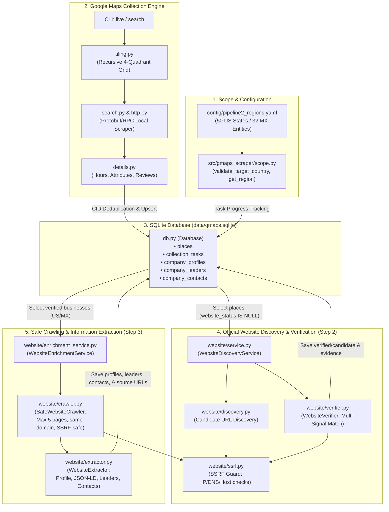
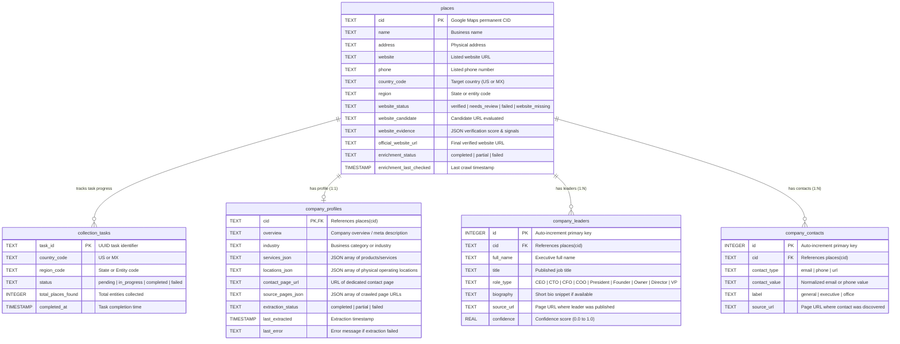

# Business Data Scraping & Enrichment Pipeline (`gmaps-scraper`)

A local-first, production-grade business data collection, website verification, and intelligence extraction pipeline.

Built from first principles with **zero external scraping APIs** (no SerpApi, Apify, or ScraperAPI), **zero third-party cloud services**, and **zero mandatory paid dependencies**. The pipeline collects geographic business entities, verifies official company domains with strict SSRF controls, safely crawls public pages, and extracts structured corporate profiles, leadership rosters, and business contact channels directly into a local SQLite repository.

---

## Table of Contents

- [A. Project Overview](#a-project-overview)
- [B. Technology Stack](#b-technology-stack)
- [C. System Architecture](#c-system-architecture)
- [D. End-to-End Data Flow](#d-end-to-end-data-flow)
- [E. Module and File Responsibilities](#e-module-and-file-responsibilities)
- [F. Database Architecture](#f-database-architecture)
- [G. Website Discovery & Multi-Signal Verification](#g-website-discovery--multi-signal-verification)
- [H. Website Crawling & Information Extraction](#h-website-crawling--information-extraction)
- [I. CLI Command Reference](#i-cli-command-reference)
- [J. Installation & Local Setup](#j-installation--local-setup)
- [K. Testing & Test Verification](#k-testing--test-verification)
- [L. Security, Reliability & Limitations](#l-security-reliability--limitations)
- [M. Implementation Status & Roadmap](#m-implementation-status--roadmap)

---

## A. Project Overview

The `gmaps-scraper` system is designed to build a high-fidelity business intelligence dataset across configured geographic scopes. It operates as a structured multi-stage pipeline:

1. **Local Business Ingestion**: Collects physical places, business metadata, coordinates, categories, and listed websites via local Google Maps endpoints using 4-quadrant adaptive spatial grid tiling.
2. **Official Website Discovery & Verification**: Identifies candidate web domains for businesses lacking URLs, and verifies existing and discovered domains using multi-signal corroboration (name tokens, title/heading tags, meta descriptions, address/phone corroboration, and directory/social platform rejection).
3. **Company & Leadership Information Extraction**: Safely traverses same-domain public website pages (e.g. About, Leadership, Team, Services, Locations, Contact) within bounded limits, extracting corporate overviews, service catalogs, operating locations, executive leadership, and business contact channels while storing exact source URLs for every attribute.

### Target Geographic Scope (Pipeline 2)
The active collection scope is strictly restricted to:
- **United States (US)**: Exactly 50 individual US States.
- **Mexico (MX)**: Exactly 32 Federal Entities (31 States + Mexico City `CDMX`, explicitly distinguishing Mexico City from the State of Mexico `MEX`).

All geographic bounds, administrative codes, and task subdivisions are declared in [`config/pipeline2_regions.yaml`](file:///r:/Roshan%20Onedata/Gmap%20scarp/gmaps-scraper/config/pipeline2_regions.yaml).

### Local-First Architecture
All data, tasks, logs, checkpoints, full-text indexes, and provenance metadata are persisted locally in SQLite (`data/gmaps.sqlite`). The system requires no third-party cloud database, telemetry agent, or external tracking servers.

---

## B. Technology Stack

The project relies strictly on a verified, minimal local Python stack:

| Component | Technology | Role in Codebase |
| :--- | :--- | :--- |
| **Language** | Python 3.10+ (tested on 3.12) | Core execution runtime. |
| **CLI Framework** | Typer & Rich | Command-line interface, progress bars, formatting, and tables. |
| **HTTP Engine** | HTTPX (`httpx>=0.27.0`) | Async HTTP client for website verification, crawling, and API requests with redirect interception. |
| **Database Engine** | SQLite3 (Standard Library) | WAL mode, FTS5 full-text indexing, JSON storage, foreign keys, and transactions. |
| **Configuration** | PyYAML & Pydantic Settings | Region manifests (`pipeline2_regions.yaml`) and typed runtime configurations. |
| **HTML Parsing** | Python Standard Library (`re`, `html`, `json`) | Zero-dependency extraction: Schema.org JSON-LD parsing, entity decoding, and text sanitization. |
| **Network Security** | Python Standard Library (`socket`, `ipaddress`, `urllib.parse`) | Multi-hop SSRF validation, private IP range blocking, loopback prevention, and URL normalization. |
| **Web UI & API** | FastAPI, Uvicorn, Jinja2 | Local dashboard on `127.0.0.1`, inspection drawers, offline `<canvas>` maps. |
| **Test Suite** | Pytest (`pytest>=9.0.0`, `pytest-asyncio`) | Unit, integration, and mocked regression testing (100 tests). |

---

## C. System Architecture

The following Mermaid diagram depicts the implemented system architecture, component boundaries, and internal data flow:



---

## D. End-to-End Data Flow

The complete pipeline executes through the following distinct steps:

```
[1. Configure Target]  ──> [2. Scope Validation]  ──> [3. Business Collection]
                                                               │
[6. URL Verification] <── [5. Website Discovery] <── [4. SQLite Upsert & CID Dedup]
         │
         ▼
[7. Same-Domain Crawl] ──> [8. Information Extract] ──> [9. Provenance Persistence]
```

1. **Scope Configuration**: [`config/pipeline2_regions.yaml`](file:///r:/Roshan%20Onedata/Gmap%20scarp/gmaps-scraper/config/pipeline2_regions.yaml) loads the 50 US States and 32 Mexico Entities with official ISO codes, names, capitals, and status tracking defaults.
2. **Target Validation**: [`scope.py:validate_target_country()`](file:///r:/Roshan%20Onedata/Gmap%20scarp/gmaps-scraper/src/gmaps_scraper/scope.py#L50) and `get_region()` enforce that any requested run strictly targets `US` or `MX` and a valid configured state code.
3. **Business Search & Collection**: [`tiling.py`](file:///r:/Roshan%20Onedata/Gmap%20scarp/gmaps-scraper/src/gmaps_scraper/tiling.py) subdivides the target bounding box into spatial tiles. For each tile, [`search.py`](file:///r:/Roshan%20Onedata/Gmap%20scarp/gmaps-scraper/src/gmaps_scraper/search.py) queries Google Maps endpoints, parsing raw place records without external browser dependencies.
4. **CID-Based Deduplication**: [`db.py:upsert_place_stub()`](file:///r:/Roshan%20Onedata/Gmap%20scarp/gmaps-scraper/src/gmaps_scraper/db.py#L415) deduplicates records on Google's permanent Customer Identification number (`cid`). Existing valid fields are preserved via `COALESCE`.
5. **Website Discovery**: For records lacking a website, [`website/discovery.py:WebsiteDiscoverer`](file:///r:/Roshan%20Onedata/Gmap%20scarp/gmaps-scraper/src/gmaps_scraper/website/discovery.py#L12) formulates safe candidate queries. Existing place websites are marked as `existing` candidates.
6. **Multi-Signal Verification & SSRF Filtering**: [`website/verifier.py:WebsiteVerifier`](file:///r:/Roshan%20Onedata/Gmap%20scarp/gmaps-scraper/src/gmaps_scraper/website/verifier.py#L46) inspects candidates:
   - Validates every hop against [`website/ssrf.py:is_safe_url()`](file:///r:/Roshan%20Onedata/Gmap%20scarp/gmaps-scraper/src/gmaps_scraper/website/ssrf.py#L45).
   - Rejects social/directory domains (Facebook, Yelp, Instagram, TripAdvisor).
   - Verifies ownership score through tokenized business name matching, page titles, H1-H3 headers, and meta descriptions.
   - Records verification status (`verified`, `needs_review`, `failed`, or `website_missing`) and JSON evidence in `places`.
7. **Safe Page Crawling**: For verified records, [`website/crawler.py:SafeWebsiteCrawler`](file:///r:/Roshan%20Onedata/Gmap%20scarp/gmaps-scraper/src/gmaps_scraper/website/crawler.py#L29) crawls up to a maximum cap (default: 5 pages per business), strictly restricted to the verified domain, prioritizing `/about`, `/team`, `/leadership`, `/services`, `/locations`, and `/contact`.
8. **Extraction**: [`website/extractor.py:WebsiteExtractor`](file:///r:/Roshan%20Onedata/Gmap%20scarp/gmaps-scraper/src/gmaps_scraper/website/extractor.py#L38) analyzes crawled HTML and JSON-LD blocks:
   - Extracts company overview, industry, service lists, locations, and contact-page URL.
   - Extracts executive leadership (`full_name`, `title`, `role_type`, `biography`, `confidence`) from Schema.org `Person` structures and HTML heading blocks.
   - Extracts business emails and telephone numbers while filtering out non-text blocks (scripts, styles, SVGs) and invalid placeholders.
9. **Provenance Persistence**: Extracted records are saved transactionally to `company_profiles`, `company_leaders`, and `company_contacts` in [`src/gmaps_scraper/db.py`](file:///r:/Roshan%20Onedata/Gmap%20scarp/gmaps-scraper/src/gmaps_scraper/db.py#L1593) with exact `source_url` provenance, enforcing unique constraints to guarantee idempotency on re-runs.

---

## E. Module and File Responsibilities

| File Path | Main Responsibility | Important Classes / Functions | Input | Output |
| :--- | :--- | :--- | :--- | :--- |
| [`src/gmaps_scraper/scope.py`](file:///r:/Roshan%20Onedata/Gmap%20scarp/gmaps-scraper/src/gmaps_scraper/scope.py) | USA/Mexico geographic validation and region manifests. | `get_target_countries()`, `validate_target_country()`, `get_region()` | Country and region code strings | Validated `RegionInfo` dataclass or `ValueError` |
| [`src/gmaps_scraper/db.py`](file:///r:/Roshan%20Onedata/Gmap%20scarp/gmaps-scraper/src/gmaps_scraper/db.py) | SQLite database management, migrations, queries, and writes. | `Database`, `init_schema()`, `upsert_place_stub()`, `save_company_profile()`, `save_company_leaders()`, `save_company_contacts()` | Place dictionaries, extracted profiles, leadership, contacts | Persisted SQLite rows, foreign keys, and indexes |
| [`src/gmaps_scraper/cli.py`](file:///r:/Roshan%20Onedata/Gmap%20scarp/gmaps-scraper/src/gmaps_scraper/cli.py) | CLI entry point and commands for operators. | `app`, `scope()`, `website_discover()`, `website_enrich()`, `live()`, `serve()` | CLI flags and options (`--country`, `--region`, `--limit`, `--dry-run`) | Terminal outputs, progress bars, and formatted Rich tables |
| [`src/gmaps_scraper/http.py`](file:///r:/Roshan%20Onedata/Gmap%20scarp/gmaps-scraper/src/gmaps_scraper/http.py) | Resilient Google Maps HTTP client. | `HttpClient`, `get_with_retry()` | URLs, query parameters, headers | Raw HTTP response bodies with exponential backoff |
| [`src/gmaps_scraper/search.py`](file:///r:/Roshan%20Onedata/Gmap%20scarp/gmaps-scraper/src/gmaps_scraper/search.py) | Google Maps Search RPC request encoding and response parsing. | `build_search_url()`, `parse_search_response()` | Coordinate bounding box, query | List of raw business dictionaries (name, CID, address, website) |
| [`src/gmaps_scraper/tiling.py`](file:///r:/Roshan%20Onedata/Gmap%20scarp/gmaps-scraper/src/gmaps_scraper/tiling.py) | 4-quadrant recursive spatial grid decomposition. | `subdivide_tile()`, `Tile` | Geographic bounding boxes | Subdivided coordinate tiles for dense spatial coverage |
| [`src/gmaps_scraper/website/ssrf.py`](file:///r:/Roshan%20Onedata/Gmap%20scarp/gmaps-scraper/src/gmaps_scraper/website/ssrf.py) | Network security and SSRF protection. | `is_safe_url()`, `is_private_ip()`, `normalize_url()` | Target candidate or redirect URLs | `(is_safe: bool, reason: Optional[str])` |
| [`src/gmaps_scraper/website/discovery.py`](file:///r:/Roshan%20Onedata/Gmap%20scarp/gmaps-scraper/src/gmaps_scraper/website/discovery.py) | Official website candidate identification. | `WebsiteDiscoverer`, `discover_candidate()` | Business dictionary from database | `(candidate_url: Optional[str], method: str)` |
| [`src/gmaps_scraper/website/verifier.py`](file:///r:/Roshan%20Onedata/Gmap%20scarp/gmaps-scraper/src/gmaps_scraper/website/verifier.py) | Multi-signal domain verification. | `WebsiteVerifier`, `verify()` | Candidate URL and business metadata | Verification status dict with score and JSON evidence |
| [`src/gmaps_scraper/website/crawler.py`](file:///r:/Roshan%20Onedata/Gmap%20scarp/gmaps-scraper/src/gmaps_scraper/website/crawler.py) | Bounded, same-domain safe website crawler. | `SafeWebsiteCrawler`, `crawl()` | Verified root URL, max page cap | Dict mapping `{page_url: PageResponse}` |
| [`src/gmaps_scraper/website/extractor.py`](file:///r:/Roshan%20Onedata/Gmap%20scarp/gmaps-scraper/src/gmaps_scraper/website/extractor.py) | Information and leadership extraction from HTML. | `WebsiteExtractor`, `extract()` | Business record and crawled pages dict | Dict with profile, leadership, contacts, and source URLs |
| [`src/gmaps_scraper/website/service.py`](file:///r:/Roshan%20Onedata/Gmap%20scarp/gmaps-scraper/src/gmaps_scraper/website/service.py) | Step 2 Website Discovery orchestration. | `WebsiteDiscoveryService`, `run_discovery()` | Target country/region, limit, dry-run | Summary statistics and updated place records |
| [`src/gmaps_scraper/website/enrichment_service.py`](file:///r:/Roshan%20Onedata/Gmap%20scarp/gmaps-scraper/src/gmaps_scraper/website/enrichment_service.py) | Step 3 Website Information Extraction orchestration. | `WebsiteEnrichmentService`, `run_enrichment()` | Target country/region, limit, max pages, dry-run | Extracted company intelligence and summary metrics |

---

## F. Database Architecture

The primary database is located at [`data/gmaps.sqlite`](file:///r:/Roshan%20Onedata/Gmap%20scarp/gmaps-scraper/data/gmaps.sqlite). The database operates in SQLite WAL mode (`PRAGMA journal_mode=WAL`) with foreign key enforcement enabled (`PRAGMA foreign_keys=ON`).

### Entity-Relationship Diagram



### Table Details & Schema Integrity

1. **`places` Table**: Stores the core business identity. `cid` serves as the primary key. Schema migrations in `db.py:init_schema()` idempotently add Pipeline 2 columns (`website_status`, `website_candidate`, `website_evidence`, `official_website_url`, `enrichment_status`) using `ALTER TABLE places ADD COLUMN ...` only when columns are missing.
2. **`collection_tasks` Table**: Manages collection job states per state/region, tracking progress, attempts, errors, and task completion.
3. **`company_profiles` Table**: Normalized 1-to-1 extension of `places`. Stores rich text overview, extracted service catalogs, physical operating branches, and the complete audit list of source pages traversed during the crawl.
4. **`company_leaders` Table**: Stores executive and management team members. Features a `UNIQUE(cid, full_name, title)` composite constraint, guaranteeing that repeated runs never create duplicate leadership rows.
5. **`company_contacts` Table**: Stores published corporate emails and telephone channels with a `UNIQUE(cid, contact_type, contact_value)` constraint to ensure idempotency.
6. **Provenance & Auditability**: Every row in `company_leaders` and `company_contacts` explicitly records the `source_url` where the record was discovered.

---

## G. Website Discovery & Multi-Signal Verification

An HTTP `200 OK` status code does **not** prove that a website officially belongs to a business. The verification engine implemented in [`src/gmaps_scraper/website/verifier.py`](file:///r:/Roshan%20Onedata/Gmap%20scarp/gmaps-scraper/src/gmaps_scraper/website/verifier.py) prevents misattribution through multi-signal evidence.

### Verification Workflow
1. **Candidate Ingestion**: Existing URLs in the Google Maps place record are tested first (`discovery_method="existing"`). If missing, candidate search queries generate candidate domains.
2. **Directory & Social Platform Rejection**: Targets matching known third-party directory or social networks (Facebook, Instagram, Yelp, YellowPages, TripAdvisor, TikTok, LinkedIn) are classified as `needs_review` and are never verified as official company sites.
3. **SSRF Guard on Initial Hop and All Redirects**: [`website/ssrf.py:is_safe_url()`](file:///r:/Roshan%20Onedata/Gmap%20scarp/gmaps-scraper/src/gmaps_scraper/website/ssrf.py#L45) inspects the host and resolved IP addresses against:
   - Loopback addresses (`127.0.0.0/8`, `::1`).
   - Private RFC1918 subnets (`10.0.0.0/8`, `172.16.0.0/12`, `192.168.0.0/16`).
   - Link-local and cloud metadata destinations (`169.254.169.254`, `fe80::/10`).
   - Disallowed protocols (only `http` and `https` permitted).
   - Any redirect to an unsafe destination terminates verification with an SSRF error.
4. **Multi-Signal Score Calculation**:
   - **Domain Stem Matching**: Extracts the domain root (e.g. `cafegrumpy` from `www.cafegrumpy.com`) and matches against business name tokens.
   - **Page Title & Heading Alignment**: Matches tokenized business name against `<title>` and `<h1>`–`<h3>` tags.
   - **Meta Description Corroboration**: Checks for presence of business name in `<meta name="description">` and `og:description`.
   - **Contact / Phone Corroboration**: Checks if the place's known telephone digits appear on the candidate page.
5. **Status Assignment**:
   - Total score $\ge 70$: `status="verified"`
   - Total score between $40$ and $69$: `status="needs_review"`
   - Score $< 40$, connection failure, or HTTP error: `status="failed"`

---

## H. Website Crawling & Information Extraction

Once a website is verified, [`src/gmaps_scraper/website/crawler.py`](file:///r:/Roshan%20Onedata/Gmap%20scarp/gmaps-scraper/src/gmaps_scraper/website/crawler.py) and [`extractor.py`](file:///r:/Roshan%20Onedata/Gmap%20scarp/gmaps-scraper/src/gmaps_scraper/website/extractor.py) extract information within safe parameters.

### Crawler Controls & Safety
- **Maximum Pages Cap**: Defaults to 5 pages per business to prevent crawler traps, deep pagination loops, and site overload.
- **Strict Same-Domain Boundary**: Subdomains and external links are strictly excluded (e.g. crawling `company.com` will not follow links to `partner.com` or third-party web apps).
- **Asset Filtering**: Ignores binary and non-HTML extensions (`.png`, `.jpg`, `.pdf`, `.zip`, `.mp4`, `.css`, `.js`, `.woff`).
- **Priority Queue**: Crawls the homepage first, parses internal links, and prioritizes paths containing:
  `about`, `team`, `leadership`, `executive`, `management`, `services`, `products`, `locations`, `contact`.

### Structured Extraction Techniques
- **Company Overview**: Extracted from Schema.org `description`, `<meta name="description">`, `og:description`, or the primary lead paragraph of an About page.
- **Services & Offerings**: Parsed from unordered lists (`<li>`) within dedicated service, menu, or offering sections.
- **Operating Locations**: Extracted from Schema.org `PostalAddress` blocks, `<address>` tags, and contact-page location blocks.
- **Public Leadership**:
  - **JSON-LD Schema**: Evaluates `<script type="application/ld+json">` for entities of type `Person` with `jobTitle` or `hasOccupation`.
  - **HTML Structure**: Matches heading patterns (e.g. `<h3>Jane Doe</h3><p class="title">Chief Executive Officer</p>`) and standard executive delimiters (`Name – Title`).
  - **Role Classification**: Normalizes titles into executive roles (`CEO`, `CTO`, `CFO`, `COO`, `President`, `Founder`, `Owner`, `Director`, `VP`).
  - **Negative Name Filter**: Rejects navigational artifacts (`About Us`, `Our Team`, `Leadership Team`, `Read Bio`, `Privacy Policy`).
  - **Zero Fabrication**: If leadership information is absent, the system records zero leaders without guessing or fabricating identities.
- **Business Contacts**:
  - Raw HTML is parsed for `<a href="mailto:...">` and `<a href="tel:...">`.
  - Scripts (`<script>`), stylesheets (`<style>`), and vector graphics (`<svg>`) are stripped before body text regex scanning to prevent false-positive matches on asset hashes, script variables, and coordinates.
  - Emails ending in asset extensions (`logo@2x.png`) or containing placeholder domains (`example.com`, `sentry.io`, `schema.org`) are rejected.
  - Distinguishes general business inboxes (`info@`, `contact@`, `hello@`, `support@`) from personal/executive emails.

---

## I. CLI Command Reference

All commands are executed via the Typer CLI entry point: `python -m gmaps_scraper <command>`.

### 1. Inspect Geographic Scope
Inspect configured Pipeline 2 target countries and states without modifying the database.

```powershell
# Show summary of configured entities (50 US States, 32 Mexico Entities)
python -m gmaps_scraper scope --summary

# Inspect all US states with live database completion metrics
python -m gmaps_scraper scope --country US

# Inspect a single state/entity
python -m gmaps_scraper scope --country US --region NY
python -m gmaps_scraper scope --country MX --region JAL
```

### 2. Live Google Maps Collection
Run a targeted local search job using adaptive tiling.

```powershell
# Collect up to 10 places in a specific city with live terminal streaming
python -m gmaps_scraper live --query "coffee" --location "Cheyenne, WY" --max-places 10 --follow

# Check live scrape job status
python -m gmaps_scraper jobs --limit 5
```

### 3. Official Website Discovery & Verification (Step 2)
Discover and verify official company websites for stored business records.

```powershell
# Dry-run: Evaluate website candidates for up to 5 businesses without writing to SQLite
python -m gmaps_scraper website-discover --country US --region WY --limit 5 --dry-run

# Run discovery and record verified websites with evidence into SQLite
python -m gmaps_scraper website-discover --country US --region WY --limit 5

# Retry previously failed or review-needed discovery tasks
python -m gmaps_scraper website-discover --country US --region WY --limit 5 --retry-failed
```

### 4. Website Information & Leadership Extraction (Step 3)
Extract company profiles, leadership rosters, and business contacts from verified websites.

```powershell
# Dry-run: Crawl and extract from verified websites without writing to SQLite
python -m gmaps_scraper website-enrich --country US --region NY --limit 4 --dry-run

# Run live enrichment: crawl pages and persist profiles, leaders, contacts, and source URLs
python -m gmaps_scraper website-enrich --country US --region NY --limit 4 --max-pages 5

# Retry previously failed enrichment tasks
python -m gmaps_scraper website-enrich --country US --region NY --limit 5 --retry-failed

# Force re-enrichment of already completed records
python -m gmaps_scraper website-enrich --country US --region NY --limit 2 --force
```

### 5. Local Web Dashboard
Launch the zero-CDN local web dashboard and places explorer on `127.0.0.1`.

```powershell
python -m gmaps_scraper serve --port 8765
```

---

## J. Installation & Local Setup

### System Requirements
- **Python**: Version 3.10 or higher (fully tested on Python 3.12).
- **Operating System**: Windows (PowerShell), Linux, or macOS.
- **Disk Space**: ~25 MB for code and dependencies; SQLite database size scales with collected places.

### Setup Steps (Windows PowerShell)

1. Clone or navigate to the repository:
   ```powershell
   cd "r:\Roshan Onedata\Gmap scarp\gmaps-scraper"
   ```

2. Create and activate a local virtual environment:
   ```powershell
   python -m venv .venv
   .\.venv\Scripts\Activate.ps1
   ```

3. Install project dependencies in editable mode:
   ```powershell
   pip install --upgrade pip
   pip install -e .
   ```

4. Initialize the database schema:
   ```powershell
   python -c "from gmaps_scraper.db import Database; db = Database('data/gmaps.sqlite'); db.init_schema()"
   ```

5. Confirm CLI availability:
   ```powershell
   python -m gmaps_scraper --help
   ```

---

## K. Testing & Test Verification

The repository contains an automated regression and unit test suite powered by `pytest`. Unit tests use local fixtures and mocked HTTP responses (`AsyncMock` / `httpx.Response`), ensuring test runs are deterministic and require no live Google Maps requests or external website connections.

### Test Commands

```powershell
# 1. Run Pipeline 2 Step 1 scope and task tracking tests (8 tests)
python -m pytest tests/test_scope_and_tasks.py -v

# 2. Run Pipeline 2 Step 2 website discovery and SSRF tests (12 tests)
python -m pytest tests/test_website_discovery.py -v

# 3. Run Pipeline 2 Step 3 website enrichment and extraction tests (14 tests)
python -m pytest tests/test_website_enrichment.py -v

# 4. Run the complete regression test suite (100 tests)
python -m pytest -v
```

### Verified Test Results

| Test Module | Coverage Area | Test Count | Status |
| :--- | :--- | :--- | :--- |
| `tests/test_scope_and_tasks.py` | US 50 States, MX 32 Entities, ISO codes, CDMX distinction, task state tracking. | 8 | **100% Passed** |
| `tests/test_website_discovery.py` | Candidate discovery, multi-signal scoring, SSRF protection, directory filtering. | 12 | **100% Passed** |
| `tests/test_website_enrichment.py` | Safe crawling, JSON-LD extraction, leadership classification, contact filtering, provenance. | 14 | **100% Passed** |
| `tests/test_parsers.py` | Google Maps Protobuf/RPC parsing, review extraction, edge cases. | 9 | **100% Passed** |
| `tests/test_tiling.py` | 4-quadrant spatial decomposition, deduplication across tiles. | 3 | **100% Passed** |
| `tests/test_resilience.py` | Resume checkpointing, adaptive backoff on 429/503 errors, data export roundtrips. | 5 | **100% Passed** |
| `tests/test_taxonomy_and_filters.py` | Vertical classification, address parsing, API faceted counts. | 10 | **100% Passed** |
| `tests/test_web.py` | Dashboard views, places explorer, XSS escaping, offline asset serving. | 16 | **100% Passed** |
| `tests/test_cleanroom_acceptance.py` | End-to-end cleanroom verification of data ingestion. | 1 | **100% Passed** |
| `tests/test_live_jobs_api.py` | Asynchronous job state machine, cooperative cancellation, SSE streaming. | 11 | **100% Passed** |
| `tests/test_db.py` | SQLite schema migrations, indexing, constraint integrity. | 11 | **100% Passed** |
| **Total Test Suite** | **Full Project Regression** | **100** | **100% Passed** |

---

## L. Security, Reliability & Limitations

### 1. SSRF Protection & Network Safety
- All candidate URLs and subsequent redirect hops are validated against private, link-local, and reserved IPv4/IPv6 blocks prior to dispatching HTTP requests.
- Requests to AWS/GCP/Azure cloud metadata endpoints (`169.254.169.254`, `metadata.google.internal`) are blocked at the socket/pre-request stage.
- Non-HTTP(S) schemes (`file://`, `gopher://`, `ftp://`) are rejected.

### 2. Crawl Politeness & Resource Limits
- Crawler enforces a strict per-host rate limit and maximum page threshold (default: 5 pages per business).
- Request timeouts default to 10.0 seconds to prevent hanging worker processes on unresponsive origin servers.
- The crawler never attempts to bypass CAPTCHA, authentication screens, paywalls, or anti-bot challenge pages. If a page returns `403 Forbidden` or challenge content, the crawler skips the page safely.

### 3. Data Preservation & Idempotency
- Updates to `places`, `company_profiles`, `company_leaders`, and `company_contacts` use `ON CONFLICT DO UPDATE` or `COALESCE` to preserve previously collected valid values.
- Running discovery or enrichment multiple times on the same business updates existing records without creating duplicate contact or leadership rows.

### 4. Technical Limitations
- **Client-Side SPA Hydration**: Websites built as Single Page Applications (React, Vue, Angular) that render content strictly via client-side JavaScript without server-side rendering or JSON-LD do not expose leadership text in raw HTTP HTML responses.
- **Contact Form Obfuscation**: Modern storefronts (e.g. Shopify-hosted sites) often replace direct `mailto:` links with hosted contact forms or third-party CRM widgets (e.g. Gorgias, Zendesk). In these cases, the system captures the dedicated contact-page URL rather than an email address.
- **Small Business Executive Rosters**: Independent retail shops, cafes, and local service providers rarely publish corporate C-suite rosters on public customer-facing web pages. The extractor strictly records that leadership was not found and avoids fabricating records.
- **Distinction Between Extracted and Validated Contacts**: Step 3 extracts raw publicly published email strings and phone numbers with source evidence. It does **not** perform SMTP mailbox handshakes, MX deliverability checks, or carrier phone validation.

---

## M. Implementation Status & Roadmap

| Pipeline Stage | Scope & Description | Current Status |
| :--- | :--- | :--- |
| **Step 1: Scope & Task Tracking** | USA (50 states) and Mexico (32 entities) scope configuration, ISO validation, `collection_tasks` tracking table, and CLI `scope` command. | **Implemented & Verified** |
| **Step 2: Official Website Discovery** | Candidate discovery, multi-signal verification scoring, SSRF safeguards, directory rejection, and CLI `website-discover` command. | **Implemented & Verified** |
| **Step 3: Company Website Extraction** | Bounded same-domain crawler, company profile extraction, JSON-LD & HTML leadership parsing, contact extraction, and CLI `website-enrich` command. | **Implemented & Verified** |
| **Step 4: Contact Validation & Quality** | Syntax hygiene, MX record verification, SMTP deliverability checks, phone formatting/validation, and cross-source deduplication. | **Planned (Pending Approval)** |
| **Step 5: Weekly Orchestration** | Scheduled recurring collection, automated re-verification, staleness tracking, and delta reporting across full country regions. | **Planned** |

---

## License & Compliance

This tool is designed for authorized local data collection and analysis. Users are responsible for complying with Google Maps Terms of Service, target website access policies (`robots.txt`), and applicable local data privacy regulations.
