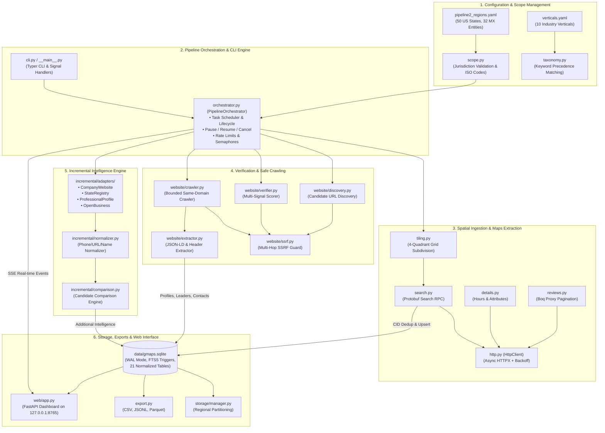
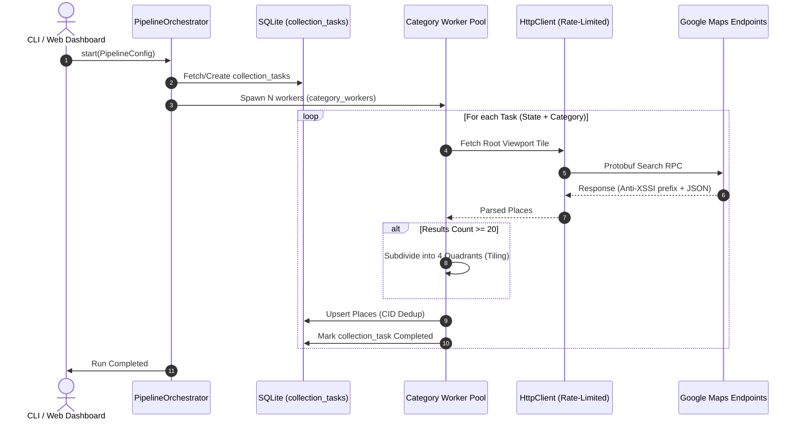
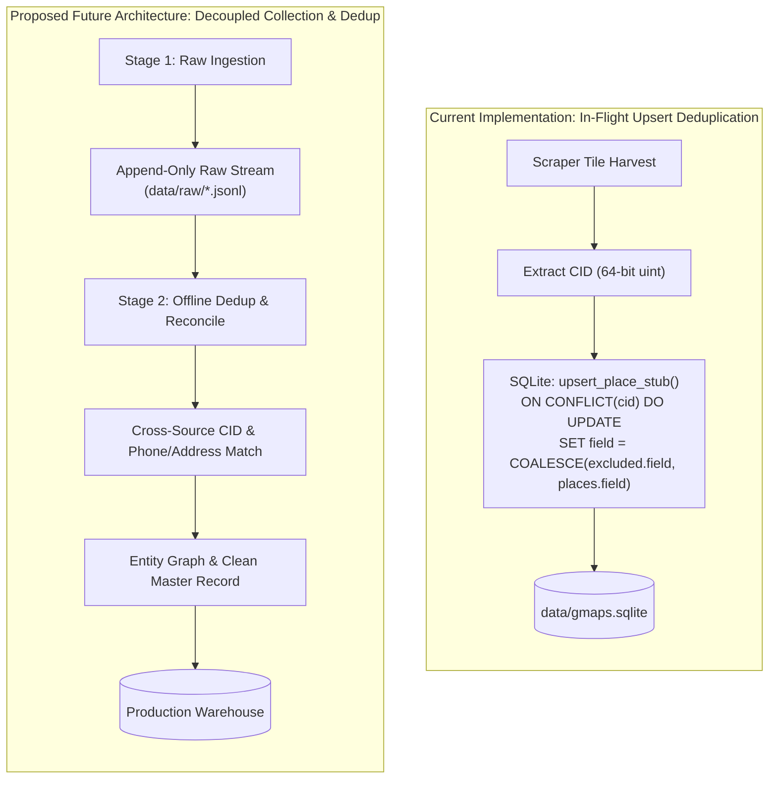

# System Architecture & Technical Design (`ARCHITECTURE.md`)

## 1. System Overview & Component Diagram

The `gmaps-scraper` application is engineered as a local-first, modular data processing system. It consists of six tightly integrated subsystems:
1. **Target Scope & Taxonomy Configuration**: Geographic boundaries (US 50 states, Mexico 32 entities) and category keyword mappings.
2. **Spatial Discovery & Google Maps Scraper**: Protobuf RPC generation, 4-quadrant grid subdivision, and details/reviews extraction.
3. **Official Website Discovery & SSRF Verification**: Domain candidate discovery, multi-hop SSRF IP protection, and multi-signal corroboration.
4. **Safe Crawler & Intelligence Extraction**: Same-domain bounded traversal, Schema.org JSON-LD parsing, and executive/contact extraction.
5. **Incremental Intelligence Engine**: Multi-adapter public querying, canonical normalization, and conflict-aware candidate comparison.
6. **Persistence, Storage Management & Web Dashboard**: Central SQLite WAL database, regional SQLite synchronization, export generators, and offline FastAPI dashboard.



---

## 2. Directory Layout & Module Responsibilities

The codebase resides in `src/gmaps_scraper/`:

```text
src/gmaps_scraper/
├── __init__.py               # Package metadata and version definition
├── __main__.py               # CLI entry point invoking cli.app()
├── config.py                 # Pydantic BaseSettings loading YAML and env vars
├── db.py                     # Central SQLite repository with 21 tables and WAL mode
├── cli.py                    # Typer command-line interface with Rich tables
├── http.py                   # Async HTTPX wrapper with rate limiting & backoff
├── search.py                 # Protobuf query generator & search RPC parser
├── tiling.py                 # 4-quadrant recursive spatial grid subdivision
├── details.py                # Place details parser for hours, attributes & thumbnail
├── reviews.py                # Boq proxy pagination extractor for reviews
├── photos.py                 # Local photo downloader into data/photos/{cid}/
├── export.py                 # Multi-format data exporter (CSV, JSONL, Parquet)
├── checkpoint.py             # Active run state tracking, counters, and ETA
├── logging_setup.py          # Rotating file logging and rich console handler
├── models.py                 # Pydantic core data schemas
├── orchestrator.py           # Multi-stage pipeline scheduler and task coordinator
├── parser_state.py           # Balanced-bracket scanner for initialization state
├── scope.py                  # Pipeline 2 US/MX country and region validator
├── taxonomy.py               # Keyword-based business vertical mapping
├── fallback_browser.py       # Playwright browser fallback stub (uninstantiated)
├── geo/                      # Geographic boundaries and natural language parsing
│   ├── boundaries.py         # State/entity bounding box coordinates
│   ├── nlparse.py            # Natural language parser into (query, location)
│   └── resolve.py            # Bounding box and coordinate resolver
├── website/                  # Step 2 & 3: Discovery, verification, and crawling
│   ├── ssrf.py               # Multi-hop SSRF validation and IP blocklist
│   ├── discovery.py          # Candidate website discovery
│   ├── verifier.py           # Multi-signal verification scoring engine
│   ├── crawler.py            # Bounded, same-domain safe page crawler
│   ├── extractor.py          # JSON-LD, profile, leadership, and contact extractor
│   ├── service.py            # Website discovery service orchestration
│   └── enrichment_service.py # Website enrichment service orchestration
├── incremental/              # Incremental intelligence & candidate comparison
│   ├── comparison.py         # Comparison engine (exact, new, conflict, unverified)
│   ├── normalizer.py         # Canonical normalizer for strings, phones, and URLs
│   ├── service.py            # Incremental enrichment orchestration service
│   ├── models.py             # Candidate findings and source check schemas
│   ├── export.py             # Intelligence export utilities
│   └── adapters/             # Modular public data source adapters
│       ├── base.py           # BaseSourceAdapter interface
│       ├── company_site.py   # Company website extended adapter
│       ├── state_registry.py # State registry public records adapter
│       ├── prof_profile.py   # Professional profile public records adapter
│       └── open_business.py  # Open business directories adapter
├── storage/                  # Regional database and backup management
│   └── manager.py            # RegionalStorageManager: state SQLite partitioning
└── web/                      # FastAPI Web Application & Dashboard
    ├── app.py                # REST endpoints, SSE streams, template routes
    ├── demo_data.py          # Safe sample data seeder for offline evaluation
    ├── static/               # Zero-CDN stylesheets and HTML5 canvas scripts
    └── templates/            # Jinja2 templates (dashboard, places, pipeline, etc.)
```

---

## 3. Execution Entry Points

1. **CLI Commands (`src/gmaps_scraper/cli.py`)**:
   - `python -m gmaps_scraper <command> [options]`
   - Direct commands for every pipeline stage: `init`, `search`, `enrich`, `reviews`, `photos`, `export`, `pipeline-plan`, `pipeline-run`, `pipeline-status`, `website-discover`, `website-enrich`, `incremental-enrich`, `storage-sync`, `serve`.
2. **Web Dashboard Server (`src/gmaps_scraper/web/app.py`)**:
   - `python -m gmaps_scraper serve --port 8765 --host 127.0.0.1`
   - FastAPI application serving visual controls, map plots, live logs, and SSE progress updates.
3. **Programmatic Python API**:
   - `from gmaps_scraper import Database, PipelineOrchestrator, ScraperConfig`

---

## 4. Task Scheduling & Concurrent Worker Execution

### 4.1 Orchestration Workflow
The `PipelineOrchestrator` (`orchestrator.py`) handles execution planning and state management:



### 4.2 Worker Concurrency Controls
The scraper controls concurrency at two distinct tiers:
1. **Category Worker Pool (`category_workers`)**:
   - Controls how many categories run in parallel within a region (default: `3`).
   - If `all_categories_concurrent: true` or `category_workers: 'all'`, all configured categories (10 standard) execute simultaneously.
2. **Network Request Semaphore (`request_concurrency` / `concurrency`)**:
   - Irrespective of the number of active category workers, outbound HTTP traffic is governed by a shared `asyncio.Semaphore` (`request_concurrency`, default: 3).
   - This prevents network saturation, socket exhaustion, and aggressive server-side throttling.

---

## 5. Data Extraction, Normalization & Deduplication

### 5.1 Protobuf RPC Extraction & Stripping
Google Maps search and details endpoints prepend an anti-XSSI security token `)]}'\n` to prevent unauthorized JSON cross-site inclusion. The scraper strips this prefix before decoding JSON payloads via `json.loads` (`search.py`, `parser_state.py`).

### 5.2 Deduplication: Current vs. Proposed Separate-Stage Architecture



- **Current Implementation**: Deduplication operates **in-flight** upon database write. Google's permanent Customer Identification number (`cid`) serves as the primary key of the `places` table. Duplicate encounters across overlapping tiles trigger an `ON CONFLICT(cid)` update using `COALESCE` to merge attributes without creating redundant rows. Uniqueness constraints on `company_leaders (cid, full_name, title)` and `company_contacts (cid, contact_type, contact_value)` prevent duplicate public leadership and contact entries.
- **Proposed Future Workflow**: High-throughput collection runs as an append-only raw ingestion stage, writing immutable JSONL dumps to disk without immediate database upserts. An offline batch deduplication stage subsequently resolves entity clusters using fuzzy phone, address, and domain matching across diverse providers.

---

## 6. Persistence, Checkpoints & Recovery

1. **Write-Ahead Logging (WAL)**: The central database executes with `PRAGMA journal_mode = WAL` and `PRAGMA synchronous = NORMAL`, ensuring concurrent reads alongside active writes without lock starvation.
2. **Atomic State Checkpoints**:
   - `collection_tasks`: Tracks status (`pending`, `running`, `completed`, `failed`), attempt counts, and error summaries per `(country, region, category)`.
   - `geographic_tiles`: Tracks spatial bounding boxes, subdivision depth, results count, and last checkpoint timestamp.
   - `pipeline_runs`: Persists orchestrator run configuration, completed task counts, and error states.
3. **Resumption**:
   - CLI: `python -m gmaps_scraper resume` or `pipeline-resume --run-id <ID>`.
   - The orchestrator checks existing task statuses in SQLite. Already-completed tasks and tiles are bypassed instantly without redundant HTTP requests.

---

## 7. Security Architecture: Multi-Hop SSRF Defense

When discovering and crawling external websites, the scraper enforces strict SSRF controls (`website/ssrf.py`):
1. **URL Scheme Whitelist**: Only `http` and `https` schemes are accepted.
2. **Pre-Flight DNS Resolution**: Target hostnames are resolved via `socket.getaddrinfo`.
3. **IP Range Blacklist**: The resolved IP is evaluated against `ipaddress.ip_network`:
   - Loopback: `127.0.0.0/8`, `::1`
   - Private Networks (RFC 1918): `10.0.0.0/8`, `172.16.0.0/12`, `192.168.0.0/16`
   - Carrier-Grade NAT: `100.64.0.0/10`
   - Link-Local & Cloud Metadata: `169.254.0.0/16`, `fe80::/10`
   - Broadcast & Unspecified: `0.0.0.0`, `255.255.255.255`
4. **Redirect Tracking**: If an external site issues an HTTP 301/302 redirect, the destination URL is intercepted and re-validated against the SSRF guard before the next request is dispatched.
