# Dataset Specification & Data Dictionary (`DATASET.md`)

## 1. Storage Architecture & Directory Layout

All data collected by the `gmaps-scraper` pipeline is persisted locally in **SQLite** with Write-Ahead Logging (`PRAGMA journal_mode = WAL`) enabled. The repository maintains a single central database as the authoritative master repository, supplemented by synchronized state-wise partitioned databases and date-partitioned exports:

```text
data/
├── gmaps.sqlite                           # Central authoritative SQLite database (21 tables)
├── databases/                             # Partitioned regional SQLite databases
│   ├── US/
│   │   ├── California_CA.sqlite
│   │   └── Texas_TX.sqlite
│   └── MX/
│       ├── Jalisco_JAL.sqlite
│       └── Ciudad_de_Mexico_CMX.sqlite
├── exports/                               # Date-stamped multi-format export bundles
│   └── 2026-10-27/
│       ├── US/
│       │   └── California_CA/
│       │       ├── California_CA_healthcare.csv
│       │       ├── California_CA_healthcare.jsonl
│       │       ├── California_CA_healthcare.parquet
│       │       └── California_CA_complete.zip
│       └── MX/
├── photos/                                # Downloaded place and review photo assets
│   └── {cid}/
│       └── {photo_id}.jpg
└── raw/                                   # Raw network RPC JSON responses for audit/debugging
```

---

## 2. Entity-Relationship Model

The central SQLite database contains 21 relational tables and full-text search triggers:

```mermaid
erDiagram
    places ||--o{ hours : "has"
    places ||--o{ attributes : "has"
    places ||--o{ reviews : "has"
    places ||--o{ photos : "has"
    places ||--o{ popular_times : "has"
    places ||--o| company_profiles : "enriches"
    places ||--o{ company_leaders : "employs"
    places ||--o{ company_contacts : "reaches"
    places ||--o{ additional_intelligence : "corroborates"
    places ||--o{ intelligence_sources : "evidenced_by"
    collection_tasks ||--o{ geographic_tiles : "decomposes_into"
    pipeline_runs ||--o{ geographic_tiles : "executes"

    places {
        TEXT cid PK "64-bit uint string"
        TEXT ftid "Google Feature ID"
        TEXT place_id "Google Place ID"
        TEXT name "Business Name"
        TEXT address "Full Address"
        TEXT street_address "Street Address"
        REAL latitude "Latitude coordinate"
        REAL longitude "Longitude coordinate"
        TEXT website "Listed Google Website"
        TEXT phone "Formatted Phone"
        TEXT phone_e164 "E.164 Standard Phone"
        TEXT category "Raw Google Category"
        TEXT vertical "Standard Vertical"
        TEXT country_code "ISO 3166-1 alpha-2"
        TEXT region "State/Entity Code"
        TEXT city "City Name"
        REAL rating "Rating (1.0 - 5.0)"
        INTEGER review_count "Review Count"
        TEXT website_status "verified / needs_review"
        TEXT official_website_url "Verified Company URL"
        TEXT enrichment_status "completed / pending"
    }

    company_profiles {
        TEXT cid PK,FK "Places CID"
        TEXT overview "Company Description"
        TEXT industry "Identified Industry"
        TEXT services_json "JSON Array of Services"
        TEXT locations_json "JSON Array of Locations"
        TEXT contact_page_url "Contact Page Link"
        TEXT source_pages_json "Crawled URLs"
        TEXT extraction_status "completed / failed"
    }

    company_leaders {
        INTEGER id PK "Auto Increment"
        TEXT cid FK "Places CID"
        TEXT full_name "Leader Name"
        TEXT title "Corporate Title"
        TEXT role_type "Executive / Board / etc."
        TEXT biography "Brief Bio"
        TEXT source_url "Provenance URL"
        REAL confidence "Confidence Score"
    }

    company_contacts {
        INTEGER id PK "Auto Increment"
        TEXT cid FK "Places CID"
        TEXT contact_type "email / phone"
        TEXT contact_value "Address or Number"
        TEXT label "general / sales / support"
        TEXT source_url "Provenance URL"
    }

    additional_intelligence {
        INTEGER id PK "Auto Increment"
        TEXT cid FK "Places CID"
        TEXT entity_type "company / person"
        TEXT field_name "Field Attribute Name"
        TEXT normalized_value "Canonical Value"
        TEXT match_status "EXACT / NEW / CONFLICT"
        REAL confidence "Confidence Score"
    }
```



---

## 3. Data Dictionary: Core Tables & Field Definitions

### 3.1 `places` Table (Master Business Record)

| Field Name | Type | Nullable | Description & Constraints |
| :--- | :--- | :--- | :--- |
| `cid` | `TEXT` | **NO** | **Primary Key**. Google 64-bit unsigned integer Customer ID (e.g., `"11785376804253324318"`). |
| `ftid` | `TEXT` | YES | Hex-encoded Feature ID (e.g., `"0x89c25bb26cc76c9f:0xa38e11c309a5d41e"`). |
| `place_id` | `TEXT` | YES | Google Place ID (e.g., `"ChIJn2zHbLJbwokRHtSlCcMRjqM"`). |
| `name` | `TEXT` | **NO** | Official business trade name. |
| `address` | `TEXT` | YES | Full formatted geographic address. |
| `street_address` | `TEXT` | YES | Normalized street-level address string. |
| `latitude` | `REAL` | YES | WGS 84 latitude coordinate (-90.0 to +90.0). |
| `longitude` | `REAL` | YES | WGS 84 longitude coordinate (-180.0 to +180.0). |
| `website` | `TEXT` | YES | Website URL listed directly on Google Maps. |
| `phone` | `TEXT` | YES | Formatted telephone number (e.g., `"(646) 449-9200"`). |
| `phone_e164` | `TEXT` | YES | E.164 standardized telephone number (e.g., `"+16464499200"`). |
| `category` | `TEXT` | YES | Primary category assigned by Google Maps. |
| `vertical` | `TEXT` | YES | Standardized industry vertical (`healthcare`, `food`, etc.). |
| `country_code` | `TEXT` | YES | Two-letter country code (`US` or `MX`). |
| `region` | `TEXT` | YES | Two/three-letter administrative state code (e.g., `CA`, `JAL`). |
| `city` | `TEXT` | YES | Extracted or geocoded city name. |
| `postal_code` | `TEXT` | YES | Postal / ZIP code string. |
| `rating` | `REAL` | YES | Average Google user review score (1.0 to 5.0). |
| `review_count` | `INTEGER`| NO | Total number of published reviews (Default: `0`). |
| `timezone` | `TEXT` | YES | IANA timezone string (e.g., `"America/New_York"`). |
| `claimed_status`| `INTEGER`| NO | Google Business Profile claimed flag (`1` = verified, `0` = unverified). |
| `photo_thumbnail`| `TEXT` | YES | CDN URL for primary thumbnail photograph. |
| `status` | `TEXT` | NO | Ingestion status (`pending`, `completed`, `failed`). |
| `website_status`| `TEXT` | YES | Verification status (`verified`, `needs_review`, `failed`, `website_missing`). |
| `official_website_url`| `TEXT` | YES | Multi-signal verified official company website URL. |
| `enrichment_status` | `TEXT` | YES | Crawl enrichment status (`pending`, `completed`, `failed`, `skipped`). |
| `created_at` | `TIMESTAMP` | NO | UTC creation timestamp (Default: `CURRENT_TIMESTAMP`). |
| `updated_at` | `TIMESTAMP` | NO | UTC last update timestamp (Default: `CURRENT_TIMESTAMP`). |

### 3.2 `company_profiles` Table

| Field Name | Type | Nullable | Description |
| :--- | :--- | :--- | :--- |
| `cid` | `TEXT` | **NO** | **Primary Key**, Foreign Key referencing `places(cid)`. |
| `overview` | `TEXT` | YES | Synthesized company summary extracted from website. |
| `industry` | `TEXT` | YES | Self-identified industry vertical. |
| `services_json` | `TEXT` | YES | JSON array of advertised services / capabilities. |
| `locations_json`| `TEXT` | YES | JSON array of physical office / operating locations. |
| `contact_page_url`| `TEXT` | YES | Direct URL to company's dedicated contact page. |
| `source_pages_json`| `TEXT` | YES | JSON array of crawled same-domain URLs. |
| `extraction_status`| `TEXT` | NO | Extraction outcome (`completed`, `failed`). |

### 3.3 `company_leaders` Table

| Field Name | Type | Nullable | Description |
| :--- | :--- | :--- | :--- |
| `id` | `INTEGER` | **NO** | **Primary Key** (Auto Increment). |
| `cid` | `TEXT` | **NO** | Foreign Key referencing `places(cid)`. |
| `full_name` | `TEXT` | **NO** | Full name of corporate executive / leader. |
| `title` | `TEXT` | **NO** | Executive job title (e.g., `"Chief Executive Officer"`). |
| `role_type` | `TEXT` | YES | Categorized executive role (e.g., `executive`, `board`, `founder`). |
| `biography` | `TEXT` | YES | Summary biography text if available on page. |
| `source_url` | `TEXT` | YES | Exact URL from which leadership record was harvested. |
| `confidence` | `REAL` | NO | Confidence score (0.0 to 1.0, Default: `1.0`). |
| *Constraint* | - | - | `UNIQUE(cid, full_name, title)` prevents duplicate entries. |

### 3.4 `company_contacts` Table

| Field Name | Type | Nullable | Description |
| :--- | :--- | :--- | :--- |
| `id` | `INTEGER` | **NO** | **Primary Key** (Auto Increment). |
| `cid` | `TEXT` | **NO** | Foreign Key referencing `places(cid)`. |
| `contact_type` | `TEXT` | **NO** | Channel type: `'email'` or `'phone'`. |
| `contact_value`| `TEXT` | **NO** | Clean email address or telephone number string. |
| `label` | `TEXT` | NO | Role label (e.g., `'general'`, `'sales'`, `'support'`). |
| `source_url` | `TEXT` | YES | Exact URL where contact channel was published. |
| *Constraint* | - | - | `UNIQUE(cid, contact_type, contact_value)` prevents duplicate entries. |

### 3.5 `additional_intelligence` Table

| Field Name | Type | Nullable | Description |
| :--- | :--- | :--- | :--- |
| `id` | `INTEGER` | **NO** | **Primary Key** (Auto Increment). |
| `cid` | `TEXT` | **NO** | Foreign Key referencing `places(cid)`. |
| `entity_type` | `TEXT` | **NO** | Entity target: `'company'` or `'person'`. |
| `field_name` | `TEXT` | **NO** | Field key (e.g., `'phone'`, `'website'`, `'executive'`). |
| `normalized_value` | `TEXT` | **NO** | Canonical normalized value string. |
| `match_status` | `TEXT` | **NO** | Match outcome (`EXACT_MATCH`, `NEW_INFORMATION`, `POSSIBLE_MATCH`, `CONFLICT`). |
| `verification_status` | `TEXT` | NO | Verification flag (`verified`, `unverified`, `disputed`). |
| *Constraint* | - | - | `UNIQUE(cid, entity_type, field_name, normalized_value)`. |

---

## 4. Synthetic Record Examples

### Example: Master Business Record (`places`)
```json
{
  "cid": "9876543210123456789",
  "ftid": "0x89c259a9b3112233:0x891234567890abcd",
  "place_id": "ChIJd8fakeplaceIdExample01",
  "name": "Apex Spine & Wellness Clinic",
  "address": "100 Medical Center Blvd, Suite 200, Austin, TX 78701",
  "street_address": "100 Medical Center Blvd, Suite 200",
  "latitude": 30.267153,
  "longitude": -97.743061,
  "website": "https://www.apexspinewellness.com",
  "phone": "(512) 555-0199",
  "phone_e164": "+15125550199",
  "category": "Chiropractor",
  "vertical": "healthcare",
  "country_code": "US",
  "region": "TX",
  "city": "Austin",
  "postal_code": "78701",
  "rating": 4.9,
  "review_count": 182,
  "timezone": "America/Chicago",
  "claimed_status": 1,
  "website_status": "verified",
  "official_website_url": "https://www.apexspinewellness.com",
  "enrichment_status": "completed"
}
```

### Example: Leadership Record (`company_leaders`)
```json
{
  "id": 104,
  "cid": "9876543210123456789",
  "full_name": "Dr. Sarah Lin",
  "title": "Clinical Director & Lead Chiropractor",
  "role_type": "executive",
  "biography": "Dr. Lin specializes in non-invasive spinal rehabilitation with over 15 years of practice.",
  "source_url": "https://www.apexspinewellness.com/about-our-team",
  "confidence": 1.0
}
```

### Example: Contact Record (`company_contacts`)
```json
{
  "id": 208,
  "cid": "9876543210123456789",
  "contact_type": "email",
  "contact_value": "appointments@apexspinewellness.com",
  "label": "general",
  "source_url": "https://www.apexspinewellness.com/contact-us"
}
```

---

## 5. Duplicate Handling & Quality Controls

1. **In-Flight Primary Key Deduplication**: Google assigns a 64-bit integer `cid` to every place. `places` table enforces `PRIMARY KEY (cid)`. Overlapping search tiles never create duplicate place rows.
2. **Non-Destructive Attribute Merging**: `ON CONFLICT(cid) DO UPDATE SET ...` uses `COALESCE(excluded.val, places.val)` so newly discovered fields populate empty slots without discarding previously verified attributes.
3. **Leadership & Contact Idempotency**: Unique compound constraints on `(cid, full_name, title)` and `(cid, contact_type, contact_value)` prevent duplicate entries across re-crawls.
4. **Conflict Isolation**: Discrepant findings discovered via external registries are recorded in `additional_intelligence` with `match_status = 'CONFLICT'` rather than silently overwriting primary place data.
