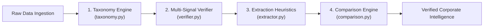

# Model & Algorithmic Documentation (`MODEL_DOCUMENTATION.md`)

## 1. Machine Learning & LLM Status: Explicit Verification

A comprehensive audit of the repository, dependency manifests ([`pyproject.toml`](file:///r:/Roshan%20Onedata/Gmap%20scarp/gmaps-scraper/pyproject.toml), [`requirements.txt`](file:///r:/Roshan%20Onedata/Gmap%20scarp/gmaps-scraper/requirements.txt)), and source modules confirms:

> [!NOTE]
> **No Machine Learning (ML) or Large Language Model (LLM) components exist in this codebase.**
> The project does **not** integrate OpenAI, Anthropic, Gemini, Ollama, LangChain, Hugging Face, PyTorch, TensorFlow, or scikit-learn.

### Design Rationale for Rule-Based Determinism
The system was engineered from first principles as an **offline-first, 100% deterministic data extraction and verification pipeline**. In place of probabilistic neural networks or generative LLMs—which incur per-token operational costs, induce network latency, suffer from non-deterministic hallucinations, and introduce vendor lock-in—the platform utilizes **high-throughput, auditable, rule-based algorithms and heuristic scoring engines**.

---

## 2. Rule-Based Classification & Matching Systems

The application incorporates four robust, deterministic algorithmic engines:

---

### 2.1 Vertical Taxonomy Classification Engine (`taxonomy.py`)

#### Purpose & Logic
Maps arbitrary raw Google Maps category strings (e.g., `"Pediatric dentist"`, `"Specialty coffee shop"`, `"Emergency veterinarian"`) into 10 standardized business verticals.

#### Algorithm & Precedence
1. Normalizes the incoming category string to lower case and strips punctuation.
2. Loads ordered vertical keyword sets from [`config/verticals.yaml`](file:///r:/Roshan%20Onedata/Gmap%20scarp/gmaps-scraper/config/verticals.yaml).
3. Evaluates substring and token matches against configured keywords in strict definition order.
4. Returns the first matching vertical key. If no keyword matches, assigns the fallback `'other'`.

#### Example Mapping Matrix
| Raw Google Category | Matched Keyword | Assigned Vertical |
| :--- | :--- | :--- |
| `"787 Coffee"` -> `"Coffee shop"` | `coffee` | `food` |
| `"Apex Spine"` -> `"Chiropractor"` | `chiropractor`| `healthcare` |
| `"Grand Hyatt"` -> `"Hotel"` | `hotel` | `hospitality` |
| `"Equinox Sports Club"` -> `"Gym"` | `gym` | `fitness` |
| `"AutoZone Auto Parts"` -> `"Auto parts store"` | `auto` | `automotive` |

---

### 2.2 Multi-Signal Website Verification Engine (`verifier.py`)

#### Purpose & Logic
Evaluates whether a candidate website URL truly belongs to the target physical business entity, filtering out parked domains, cyber-squatters, Yelp/TripAdvisor directory listings, and generic social media profiles.

#### Multi-Signal Scoring Heuristic
The `WebsiteVerifier` computes an ownership confidence score ($S \in [0.0, 1.0]$) across multiple independent signals:

1. **Directory & Social Platform Exclusion**:
   - Compares the candidate domain against a blacklist: `facebook.com`, `instagram.com`, `twitter.com`, `x.com`, `yelp.com`, `tripadvisor.com`, `yellowpages.com`, `linkedin.com`, `mapquest.com`.
   - If matched, the candidate is immediately classified as `failed` / non-official.
2. **Business Name Token Overlap ($S_{\text{name}}$)**:
   - Tokenizes the business name into significant words (excluding corporate suffixes like `Inc`, `LLC`, `Corp`, `Co`, `Ltd`).
   - Computes Jaccard / token containment against the domain name and URL slug.
3. **HTML Document Title Corroboration ($S_{\text{title}}$)**:
   - Extracts the `<title>` tag content.
   - Evaluates token containment of the business name within the title.
4. **Header & Meta Description Analysis ($S_{\text{header}}$)**:
   - Scans `<h1>`, `<h2>`, and `<meta name="description">` tags for business name and geographic tokens (city, state).
5. **Contact Corroboration ($S_{\text{contact}}$)**:
   - Checks for presence of the listed telephone number (digits only) or street address tokens on the homepage.

#### Decision Thresholds
- **Verified ($S \ge 0.65$)**: Candidate domain confirmed as official website (`website_status = 'verified'`).
- **Needs Review ($0.35 \le S < 0.65$)**: Ambiguous match; logged for review (`website_status = 'needs_review'`).
- **Failed ($S < 0.35$)**: Insufficient corroboration or domain mismatch (`website_status = 'failed'`).

---

### 2.3 Information Extraction Heuristics (`extractor.py`)

#### Purpose & Logic
Extracts executive leadership rosters, corporate descriptions, and verified contact channels from crawled HTML documents without using external computer-vision or generative AI models.

#### Extraction Algorithms
1. **Schema.org Structured JSON-LD Parser**:
   - Scans HTML documents for `<script type="application/ld+json">` blocks.
   - Decodes nested JSON payloads, targeting `@type` values: `Person`, `Organization`, `LocalBusiness`, `Corporation`.
   - Extracts `name`, `jobTitle`, `email`, `telephone`, and `description`.
2. **HTML Header & Card Pattern Scanner**:
   - For websites lacking JSON-LD, traverses DOM heading tags (`<h3>`, `<h4>`, `<h5>`) within parent containers matching team classes: `.team`, `.leadership`, `.executives`, `.about-us`, `.board-members`.
   - Pairs identified person names with adjacent title elements using proximity heuristics and keyword filters (`CEO`, `President`, `Director`, `Founder`, `Partner`, `Manager`, `Doctor`, `Principal`).
3. **Regex-Based Contact Channel Extractor**:
   - **Email Extraction**: RFC 5322 compliant regex with false-positive exclusion (filters out `.png`, `.jpg`, `.svg`, `.webp`, `sentry`, `example.com`, tracking pixels).
   - **Telephone Extraction**: International E.164 and North American Numbering Plan (NANP) regex matching formatted numbers, validated against minimum digit counts.

---

### 2.4 Incremental Comparison Engine (`comparison.py`)

#### Purpose & Logic
Compares newly harvested candidate intelligence against existing database values, eliminating duplicate insertions while isolating real-world discrepancies.

#### Matching Taxonomy
- **`EXACT_MATCH`**: Normalized candidate value equals existing database value (e.g., identical telephone or domain).
- **`NEW_INFORMATION`**: Target field was currently empty (`NULL` or empty string). Candidate value is promoted to primary record non-destructively.
- **`POSSIBLE_MATCH`**: High token overlap or phonetic similarity (e.g., `"Dr. Robert Smith"` vs `"Bob Smith"`), marked for operator review.
- **`CONFLICT`**: Direct contradiction detected between two distinct values (e.g., different company phone numbers). Existing record is preserved, and the conflicting observation is recorded in `additional_intelligence` with `match_status = 'CONFLICT'`.
- **`UNVERIFIED`**: Candidate source provided incomplete or ambiguous metadata.
